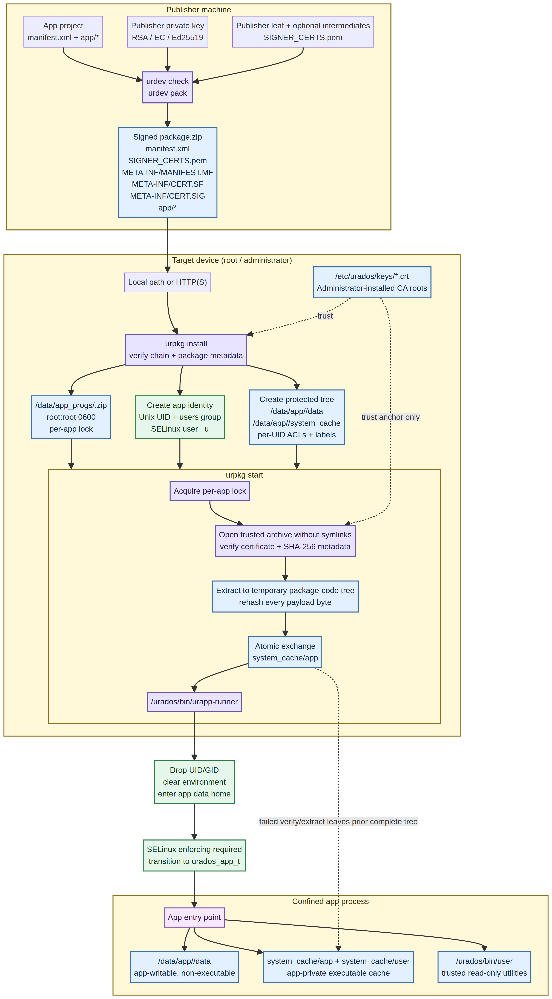

# Urados

Urados is a full operating system built around a secure, native Linux application runtime. It provides the system foundation, device integration points, package lifecycle, application isolation, and SELinux-based confinement needed to operate a complete device or product environment.

The creators of Urados also offer selected parts of the operating system as open-source software under the name **Urados Open Source Software (UOSS)**. UOSS lets you integrate useful Urados components—such as package management, signing, application sandboxing, policy, and supporting system utilities—into another operating system or existing product without adopting the entire Urados OS. The availability and license of each component are defined by the component’s source repository and license.

It provides two command-line tools:

- `urdev` creates an app project, validates its manifest, generates signing material or a CSR, and builds a signed package.
- `urpkg` verifies, installs, and starts signed packages on a device.

At runtime, each app gets its own Unix UID and SELinux user/domain. POSIX ACLs isolate writable data and executable cache content between apps, while the SELinux policy prevents ordinary app data from being executed directly.



## Status and scope

Urados is intended to be used as a complete operating system, while other systems can adopt the components published as UOSS independently. This repository documents and implements the Urados application runtime and its supporting system components; it is not a general-purpose desktop package ecosystem. Device integration requires a prepared SELinux base policy, an administrator-managed trust directory, the `/urados` runtime layout, and an enforcing SELinux configuration. The staged `--root` mode used by tests is useful for development, but it is **not** a security boundary and does not emulate SELinux enforcement.

## Urados OS and UOSS

**Urados OS** is the complete operating-system offering: an integrated system image and platform that can be adapted for a device or product. It includes the surrounding system configuration and integration required to boot, manage, secure, update, and run applications on a target device.

**Urados Open Source Software (UOSS)** is the open-source software made available from the Urados platform for reuse outside the complete OS. Organizations can select and integrate individual UOSS components into their own operating systems, firmware, distributions, or products. For example, this repository’s package manager, developer tooling, signing workflow, filesystem layout, launcher, and SELinux policy are designed as separable building blocks as well as parts of the broader Urados platform.

UOSS is intended to make collaboration and integration practical: adopters can use the parts they need, contribute improvements, and maintain their own system integration. Review the repository and component licenses before redistribution or commercial deployment; open-source availability does not imply that every Urados OS service, image, configuration, or integration is included in UOSS.

## How it works

1. A publisher creates an app directory containing `manifest.xml` and an `app/` payload.
2. `urdev pack` hashes the package contents and creates an APK/JAR-style SHA-256 metadata set: `META-INF/MANIFEST.MF`, `META-INF/CERT.SF`, and `META-INF/CERT.SIG`. The package also carries the publisher leaf certificate and any intermediate certificates in `SIGNER_CERTS.pem`.
3. A device administrator installs only public, self-signed CA roots as `.crt` files in `/etc/urados/keys/`.
4. `urpkg install` accepts a local path or HTTP(S) URL, verifies the certificate chain and package metadata, stores the verified archive as a root-owned `0600` file, creates the app identity and protected directories, and extracts the initial package code.
5. `urpkg start` takes the per-app lock, verifies the root-owned archive through a pinned file descriptor, extracts a fresh package-code tree, atomically publishes it, and launches the manifest entry through `/urados/bin/urapp-runner`.
6. The runner requires SELinux to be enabled and enforcing, drops to the app UID/GID, enters the app data home, clears the inherited environment, and transitions to `urados_app_t`.

A failed verification or extraction does not replace the previous complete package-code tree. The trusted archive, not the mutable cache, is the source of truth for package verification.

## Repository layout

| Path | Purpose |
| --- | --- |
| `pkg_mgr/src/` | C implementation of `urpkg`, `urdev`, the launcher, packaging, verification, extraction, and SELinux integration. |
| `pkg_mgr/include/` | Shared package-manager definitions and public internal interfaces. |
| `pkg_mgr/tests/` | Certificate, extraction-limit, and staged end-to-end tests. |
| `selinux/urados.te` | Urados SELinux types, transitions, permissions, and neverallow guarantees. |
| `selinux/urados.fc` | File-context rules for app data, code, trusted utilities, libraries, IPC, and tools. |
| `selinux/build.sh` | Builds and optionally installs the policy and runtime binaries. |
| `ipc/setup-ipc-user.sh` | Creates the optional group-owned IPC runtime directory. |
| `docs/APP-SANDBOX.md` | Detailed filesystem, ACL, process, and migration model. |
| `docs/CODE-SIGNING.md` | Publisher, CA operator, and device administrator signing workflow. |
| `docs/BUILD.md` | Distribution-specific build dependencies and test prerequisites. |

## Build requirements

Urados is written in C11 and uses `make`, `pkg-config`, libxml2, libzip, libcurl, OpenSSL 3, libselinux, libsemanage, and libacl. Install the platform-specific development packages described in [`docs/BUILD.md`](docs/BUILD.md), then build:

```sh
make -j2
```

The resulting binaries are placed in `pkg_mgr/build/`:

- `urpkg` — device package manager
- `urdev` — developer and publisher tool
- `apprestorecon` — repairs Urados SELinux user mappings and file labels
- `urapp-runner` — privileged-to-confined launch helper

To install the tools using the top-level Makefile:

```sh
sudo make install
```

For a device-oriented build that also compiles the policy:

```sh
./selinux/build.sh
```

Loading policy changes the active policy on the machine and requires root. The Urados module declares its own types, users, and roles, so it needs no hand-edited base-policy file. Do not use `--install-policy` on a host where the policy is not expected to change; see [`docs/APP-SANDBOX.md`](docs/APP-SANDBOX.md).

## Create and sign an app

Create a project skeleton:

```sh
urdev init ./my-app my-app 1.0.0
```

Put the application entry point and other payload files under `./my-app/app/`. The generated manifest points at `system_cache/app/<entry>` after installation. Validate the project before packaging:

```sh
urdev check ./my-app
```

Generate a publisher key and CSR locally. Keep the private key on the publisher machine:

```sh
urdev keygen company-private.pem company-public.pem
urdev csr company-private.pem company.csr \
  --country US \
  --organization "Example Company" \
  --common-name "Example Publisher"
```

After a CA approves the CSR, concatenate the publisher leaf certificate followed by any intermediate certificates, then package the app:

```sh
cat company-signing.crt issuing-intermediate.crt > company-chain.pem
urdev pack ./my-app my-app-1.0.0.zip \
  --key company-private.pem \
  --cert company-chain.pem
```

The package private key is never copied into the ZIP. The certificate chain must be for code signing, and the device must trust the chain through an installed CA root. See [`docs/CODE-SIGNING.md`](docs/CODE-SIGNING.md) for certificate requirements and the complete workflow.

## Verify, install, and start

Install the device administrator’s public CA root under `/etc/urados/keys/`, then verify a package before installation:

```sh
sudo install -d -m 0755 /etc/urados/keys
sudo install -m 0644 urados-root.crt /etc/urados/keys/urados-root.crt
urpkg verify my-app-1.0.0.zip
```

Install from a local path or HTTP(S) URL:

```sh
sudo urpkg install my-app-1.0.0.zip
sudo urpkg start my-app -- hello world
```

`start` refreshes the immutable package-code directory from the root-owned signed archive before launching. App-created files under `system_cache/user` remain mutable across starts, while ordinary app data is stored under `/data/app/<name>/data` and is not executable by the app domain.

For staged testing without touching the host’s `/data` or account files, use the `--root DIR` option. This mode is intentionally not a production security boundary.

## Security model

The main boundaries are:

- **Package authenticity:** certificate chain validation, code-signing EKU and key usage checks, publisher signature verification, and SHA-256 metadata verification for every package file.
- **Trusted storage:** installed archives live at `/data/app_progs/<name>.zip`, owned by `root:root` with mode `0600`; per-app locks serialize installation and start operations.
- **Filesystem isolation:** each app has a distinct Unix UID but uses the shared `users` primary group. Root-owned parents and per-UID ACLs prevent one app from reading or modifying another app’s data or cache.
- **SELinux confinement:** the launcher transitions into the per-app `urados_app_t` domain. Ordinary app data is labeled non-executable; only the app’s code cache, trusted read-only utilities, and configured libraries are executable.
- **Fail-closed launch:** production start refuses to run if SELinux is disabled or permissive, the helper is missing or mislabeled, or the helper is launched from the wrong domain.

The design deliberately supports mutable app-created code in `system_cache/user`. Package verification protects the signed archive; it does not treat that mutable cache as trusted package content. Interpreted shell scripts remain a separate consideration: a trusted shell can interpret a readable script even when the kernel would deny direct execution of that script file.

## Tests

Build and run the certificate and staged end-to-end suites with:

```sh
make test
```

The end-to-end suite additionally needs passwordless `sudo`, ACL utilities such as `getfacl`, SELinux policy tooling, and a usable local SELinux policy store. It stages its account, policy, and filesystem changes under `pkg_mgr/build/test/root` and is designed not to modify the host policy store.

The policy module can be compiled without loading it:

```sh
sh selinux/test/build.sh
```

`selinux/test/verify.sh` checks the module against the installed reference policy when that reference policy is available. Passing staged tests or compiling the module does not prove that a target device is correctly enforcing the intended runtime policy; verify the device-specific SELinux transitions, labels, and cross-app access rules on the target image.

## Documentation

- [Building Urados](docs/BUILD.md)
- [App filesystem and execution model](docs/APP-SANDBOX.md)
- [X.509 package signing](docs/CODE-SIGNING.md)
- [Updated package and runtime flow](docs/images/flow.png)

## License

Urados is licensed under the [Apache License 2.0](LICENSE).
