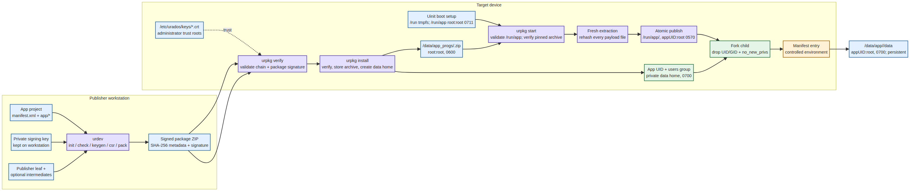
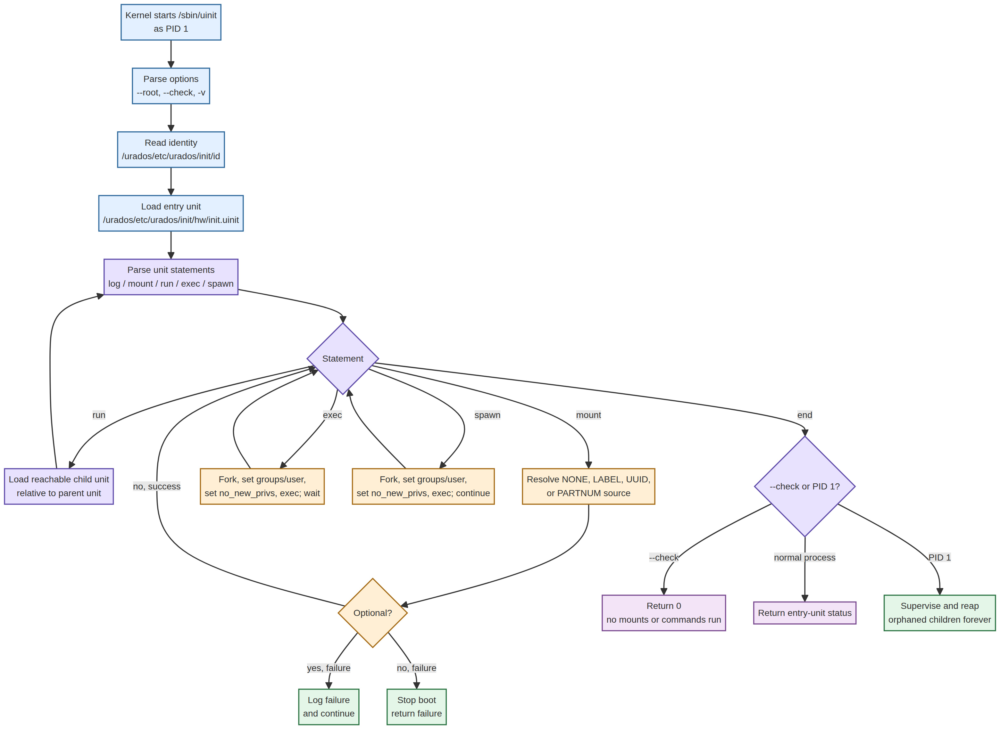

# Urados

Urados is a full operating system built around a secure, native Linux application runtime. It provides the system foundation, device integration points, package lifecycle, and application isolation needed to operate a complete device or product environment. Application isolation uses only standard UNIX mechanisms (users, file modes, POSIX ACLs, and `no_new_privs`); there is no SELinux policy.

The creators of Urados also offer selected parts of the operating system as open-source software under the name **Urados Open Source Software (UOSS)**. UOSS lets you integrate useful Urados components—such as package management, signing, application sandboxing, policy, and supporting system utilities—into another operating system or existing product without adopting the entire Urados OS. The availability and license of each component are defined by the component’s source repository and license.

It provides two system components and three primary binaries:

- `urdev` creates an app project, validates its manifest, generates signing material or a CSR, and builds a signed package.
- `urpkg` verifies, installs, and starts signed packages on a device.
- `uinit` is the native init system. It can run as PID 1 or validate and boot a staged root during development.

At runtime, each app gets its own Unix UID and a folder named after the app. POSIX ACLs isolate writable data and executable cache content between apps. App names are restricted to `[a-z_][a-z0-9_-]*` (at most 32 bytes) so they are safe as both user names and ext4 file and folder names.





## Status and scope

Urados is intended to be used as a complete operating system, while other systems can adopt the components published as UOSS independently. This repository documents and implements the Urados application runtime and its supporting system components; it is not a general-purpose desktop package ecosystem. Device integration requires an administrator-managed trust directory and the `/urados` runtime layout. The staged `--root` mode used by tests is useful for development, but it is **not** a security boundary.

## Urados OS and UOSS

**Urados OS** is the complete operating-system offering: an integrated system image and platform that can be adapted for a device or product. It includes the surrounding system configuration and integration required to boot, manage, secure, update, and run applications on a target device.

**Urados Open Source Software (UOSS)** is the open-source software made available from the Urados platform for reuse outside the complete OS. Organizations can select and integrate individual UOSS components into their own operating systems, firmware, distributions, or products. For example, this repository’s package manager, developer tooling, signing workflow, and filesystem layout are designed as separable building blocks as well as parts of the broader Urados platform.

UOSS is intended to make collaboration and integration practical: adopters can use the parts they need, contribute improvements, and maintain their own system integration. Review the repository and component licenses before redistribution or commercial deployment; open-source availability does not imply that every Urados OS service, image, configuration, or integration is included in UOSS.

## How it works

1. A publisher creates an app directory containing `manifest.xml` and an `app/` payload.
2. `urdev pack` hashes the package contents and creates an APK/JAR-style SHA-256 metadata set: `META-INF/MANIFEST.MF`, `META-INF/CERT.SF`, and `META-INF/CERT.SIG`. The package also carries the publisher leaf certificate and any intermediate certificates in `SIGNER_CERTS.pem`.
3. A device administrator installs only public, self-signed CA roots as `.crt` files in `/etc/urados/keys/`.
4. `urpkg install` accepts a local path or HTTP(S) URL, verifies the certificate chain and package metadata, stores the verified archive as a root-owned `0600` file, creates the app account and protected directories, and extracts the initial package code.
5. `urpkg start` takes the per-app lock, verifies the root-owned archive through a pinned file descriptor, extracts a fresh package-code tree, atomically publishes it, and launches the manifest entry.
6. The launch runs in a forked child that drops to the app UID/GID, makes root unrecoverable, sets `no_new_privs`, enters the app data home, and clears the inherited environment before exec.

A failed verification or extraction does not replace the previous complete package-code tree. The trusted archive, not the mutable cache, is the source of truth for package verification.

## Repository layout

| Path | Purpose |
| --- | --- |
| `pkg_mgr/src/` | C implementation of `urpkg`, `urdev`, packaging, verification, extraction, and app launch. |
| `pkg_mgr/include/` | Shared package-manager definitions and public internal interfaces. |
| `pkg_mgr/tests/` | Certificate, extraction-limit, and staged end-to-end tests. |
| `init/src/` | Uinit boot, unit parsing, mounts, process execution, and supervision. |
| `init/include/` | Uinit public internal definitions and paths. |
| `init/tests/` | Uinit parser, staged boot, identity, mount, and PID 1 tests. |
| `init/examples/` | Example identity file and unit tree for `make -C init check-example`. |
| `ipc/setup-ipc-user.sh` | Creates the optional group-owned IPC runtime directory. |
| `docs/APP-SANDBOX.md` | Detailed filesystem, ACL, process, and migration model. |
| `docs/CODE-SIGNING.md` | Publisher, CA operator, and device administrator signing workflow. |
| `docs/BUILD.md` | Dependencies, build modes, tests, installation, and static Uinit linking. |
| `docs/PACKAGE-MANAGER.md` | `urdev` and `urpkg` workflow, commands, package format, and trust setup. |
| `docs/UINIT.md` | Uinit boot layout, unit syntax, options, tests, and integration checklist. |

## Build requirements

Urados is written in C11. Install the platform-specific development packages described in [`docs/BUILD.md`](docs/BUILD.md), then choose a build:

```sh
make -j2              # package manager and Uinit
make pkg_mgr -j2      # urpkg and urdev only
make uinit -j2        # Uinit only
```

The resulting binaries are placed in:

- `pkg_mgr/build/urpkg` — device package manager
- `pkg_mgr/build/urdev` — developer and publisher tool
- `init/build/uinit` — init system

To statically link one `pkg-config` library and its dependencies into Uinit only:

```sh
make uinit STATIC_LIB=blkid
```

To install the tools using the top-level Makefile:

```sh
sudo make install
```

## Create and sign an app

Create a project skeleton:

```sh
urdev init ./my-app my-app 1.0.0
```

Put the application entry point and other payload files under `./my-app/app/`. The generated manifest points at `system_cache/app/<entry>` after installation. Validate the project before packaging:

```sh
urdev check ./my-app
```

Generate a publisher key and CSR locally. Keep the private key on the publisher machine:

```sh
urdev keygen company-private.pem company-public.pem
urdev csr company-private.pem company.csr \
  --country US \
  --organization "Example Company" \
  --common-name "Example Publisher"
```

After a CA approves the CSR, concatenate the publisher leaf certificate followed by any intermediate certificates, then package the app:

```sh
cat company-signing.crt issuing-intermediate.crt > company-chain.pem
urdev pack ./my-app my-app-1.0.0.zip \
  --key company-private.pem \
  --cert company-chain.pem
```

The package private key is never copied into the ZIP. The certificate chain must be for code signing, and the device must trust the chain through an installed CA root. See [`docs/CODE-SIGNING.md`](docs/CODE-SIGNING.md) for certificate requirements and the complete workflow.

## Verify, install, and start

Install the device administrator’s public CA root under `/etc/urados/keys/`, then verify a package before installation:

```sh
sudo install -d -m 0755 /etc/urados/keys
sudo install -m 0644 urados-root.crt /etc/urados/keys/urados-root.crt
urpkg verify my-app-1.0.0.zip
```

Install from a local path or HTTP(S) URL:

```sh
sudo urpkg install my-app-1.0.0.zip
sudo urpkg start my-app -- hello world
```

`start` refreshes the immutable package-code directory from the root-owned signed archive before launching. App-created files under `system_cache/user` remain mutable across starts, while ordinary app data is stored under `/data/app/<name>/data` and is not executable by the app domain.

For staged testing without touching the host’s `/data` or account files, use the `--root DIR` option. This mode is intentionally not a production security boundary.

## Security model

The main boundaries are:

- **Package authenticity:** certificate chain validation, code-signing EKU and key usage checks, publisher signature verification, and SHA-256 metadata verification for every package file.
- **Trusted storage:** installed archives live at `/data/app_progs/<name>.zip`, owned by `root:root` with mode `0600`; per-app locks serialize installation and start operations.
- **Filesystem isolation:** each app has a distinct Unix UID but uses the shared `users` primary group. Root-owned parents and per-UID ACLs prevent one app from reading or modifying another app’s data or cache.
- **Process confinement:** the app process runs with exactly its own UID and the `users` group, cannot regain root, and has `no_new_privs` set so setuid binaries cannot raise its privilege.
- **Name safety:** app names are limited to `[a-z_][a-z0-9_-]*`, so they cannot contain path separators, dots, or other characters unsafe in a file name.

Known limit: without SELinux, an app can write a program into its own `data/` folder and run it, and interpreted scripts are not restricted. See [`docs/APP-SANDBOX.md`](docs/APP-SANDBOX.md) for what UNIX permissions do not stop.

The design deliberately supports mutable app-created code in `system_cache/user`. Package verification protects the signed archive; it does not treat that mutable cache as trusted package content. Interpreted shell scripts remain a separate consideration: a trusted shell can interpret a readable script even when the kernel would deny direct execution of that script file.

## Tests

Build and run the package-manager certificate and staged end-to-end suites with:

```sh
make test
```

The end-to-end suite additionally needs passwordless `sudo` and ACL utilities such as `getfacl`. It stages its account and filesystem changes under `pkg_mgr/build/test/root`, so no real account or `/data` path is touched.

Passing staged tests does not prove the layout on a device. On the target, verify that each app runs as its own UID, and that one app cannot read or write another app’s data or cache.

Run the Uinit parser, staged boot, identity, mount, and PID 1 tests with:

```sh
make -C init test
```

For a configuration-only check that performs no mounts or commands:

```sh
make -C init check-example
```

## Documentation

- [Building Urados](docs/BUILD.md)
- [Package manager and developer tools](docs/PACKAGE-MANAGER.md)
- [Uinit init system](docs/UINIT.md)
- [App filesystem and execution model](docs/APP-SANDBOX.md)
- [X.509 package signing](docs/CODE-SIGNING.md)
- [Package-manager lifecycle diagram](docs/images/flow.png)
- [Uinit boot-flow diagram](docs/images/uinit.png)

## License

Urados is licensed under the [Apache License 2.0](LICENSE).
