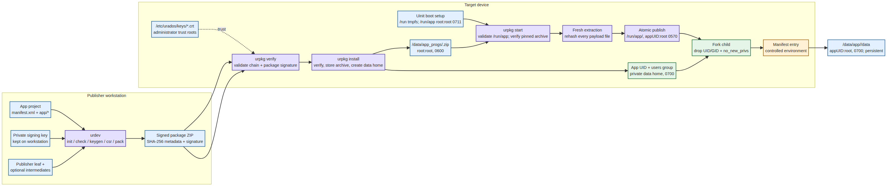

# Package manager and developer tools

The package-manager component is in `pkg_mgr/` and produces two binaries:

- `urdev` runs on a publisher or developer workstation. It creates projects, validates manifests, creates keys and CSRs, and signs packages.
- `urpkg` runs with administrator privileges on a device. It verifies, installs, and starts signed packages.

The package format is an APK/JAR-style ZIP with SHA-256 metadata. See [X.509 package signing](CODE-SIGNING.md) for certificate policy and CA operations.



## Build

From the repository root:

```sh
make pkg_mgr
```

The binaries are written to `pkg_mgr/build/`. For dependencies, tests, installation, and static Uinit linking, see [Building Urados](BUILD.md).

## Create a project

Create a skeleton project with a safe application name:

```sh
urdev init ./my-app my-app 1.0.0
```

The generated project contains `manifest.xml` and an `app/` directory. Put the application entry point and payload files below `app/`. Application names must match `[a-z_][a-z0-9_-]*` and be no longer than 32 bytes.

Validate the project before signing:

```sh
urdev check ./my-app
```

The check validates the manifest and entry path without creating an install or device state.

## Create publisher credentials

Generate a private key locally. Keep it secret and do not copy it to the device or CA host:

```sh
urdev keygen company-private.pem company-public.pem
```

By default the private key is encrypted. For a development-only key without a passphrase:

```sh
urdev keygen company-private.pem company-public.pem --no-passphrase
```

Create a CSR and send only the CSR to the certificate authority:

```sh
urdev csr company-private.pem company.csr \
  --country US \
  --organization "Example Company" \
  --common-name "Example Publisher" \
  --email developer@example.com
```

The signing certificate must be a publisher leaf with `digitalSignature` key usage and `codeSigning` extended key usage. The package contains the publisher leaf followed by any intermediate certificates; it does not contain the trusted root.

## Build a signed package

Concatenate the leaf certificate first, followed by any intermediate certificates:

```sh
cat company-signing.crt issuing-intermediate.crt > company-chain.pem
```

Create the signed package:

```sh
urdev pack ./my-app my-app-1.0.0.zip \
  --key company-private.pem \
  --cert company-chain.pem
```

The package contains:

```text
manifest.xml
SIGNER_CERTS.pem
META-INF/MANIFEST.MF
META-INF/CERT.SF
META-INF/CERT.SIG
app/...
```

The private key is never copied into the ZIP. `META-INF/MANIFEST.MF` hashes the package content, `CERT.SF` signs the manifest metadata, and `CERT.SIG` contains the publisher signature over `CERT.SF`.

## Configure device trust

The device administrator installs only public, self-signed CA roots in the trust directory:

```sh
sudo install -d -m 0755 /etc/urados/keys
sudo install -m 0644 urados-root.crt /etc/urados/keys/urados-root.crt
```

Each `.crt` file must contain one complete PEM-encoded self-signed CA certificate with `CA:TRUE` and `keyCertSign`. Do not install the CA private key. There is no unsigned-package or raw-public-key compatibility mode.

## Verify, install, and start

Verify a package before changing device state:

```sh
urpkg verify my-app-1.0.0.zip
```

Install from a local path or HTTP(S) URL:

```sh
sudo urpkg install my-app-1.0.0.zip
sudo urpkg install https://example.invalid/releases/my-app-1.0.0.zip
```

Start an installed application and pass arguments after the application name:

```sh
sudo urpkg start my-app -- hello world
```

`urpkg install` verifies and stores the signed archive, creates the app identity, and creates its private data home. It does not persist an extracted package-code tree. `urpkg start` verifies the root-owned archive again, extracts the payload into a fresh tree under `/run/app/<name>`, atomically publishes it, drops privileges in the child process, sets `no_new_privs`, clears the inherited environment, and executes the manifest entry from that runtime tree. The established manifest prefix `system_cache/app/` remains accepted for package compatibility and is mapped to the payload root under `/run/app/<name>`.

## Command reference

### `urdev`

```text
urdev init   <dir> <name> [version]
urdev check  <dir>
urdev keygen <private.pem> <public.pem> [--no-passphrase]
urdev csr    <private.pem> <request.csr> [subject options]
urdev pack   <dir> <out.zip> --key FILE --cert CHAIN.pem
```

CSR subject options are `--common-name`, `--country`, `--state`, `--locality`, `--organization`, `--organizational-unit`, and `--email`. `--common-name` is required.

### `urpkg`

```text
urpkg [--root DIR] [--keys DIR] verify <package.zip>
urpkg [--root DIR] [--keys DIR] install <source>
urpkg [--root DIR] [--keys DIR] start <name> [args...]
urpkg [--root DIR] [--keys DIR] stop [--force] [--timeout SEC] <name>
urpkg [--root DIR] [--keys DIR] update [--force] [--timeout SEC] <source>
urpkg [--root DIR] [--keys DIR] uninstall [--force] [--timeout SEC] <name>
```

`--keys DIR` selects the administrator trust directory. By default it is `<root>/etc/urados/keys`. `--root DIR` prefixes device paths and is intended for staged development and tests; it is not a security boundary.

### Stop, update and uninstall

These three commands control an installed app's life cycle after `start`:

- `stop <name>` ends every process the app is running. It sends `SIGTERM` to each process that runs under the app's UID inside the target root, which includes detached children, and sends `SIGKILL` to any that remain after `--timeout SEC` (default 5, range 0-600). `--force` sends `SIGKILL` at once. The command returns once the app's per-app lock is free, so no `start` is still running. Stopping an app that is not running succeeds.
- `update <source>` replaces an installed app with a newer signed package. `<source>` is a local path or an http(s) URL. The new package is verified before anything is stopped. It must have the same app name, be signed by the same publisher key as the installed version (the SHA-256 of the signer's SubjectPublicKeyInfo, so a renewed certificate for the same key still matches), and have a strictly newer version. Versions compare with Debian-style ordering. Downgrades and re-installing the same version are refused. Once the checks pass, the app is stopped under the per-app lock, the trusted archive is replaced atomically, and the old runtime tree is removed. The account, private data and lock are kept. The next `start` extracts the new package.
- `uninstall <name>` stops the app and removes its account, runtime tree, trusted package, private data home and lock file, in that order. The account goes first so the app cannot run again during removal. Running `uninstall` again after an interruption finishes the removal, and removing an app that is not installed fails.

Both `stop` and `uninstall` signal only processes whose real UID belongs to the app account and that live inside the target root. They never signal root's processes. `update` and `uninstall` take the same per-app lock as `start` and `install`, so they never run alongside a start.

On the device (without `--root`), `urpkg` resolves existing users and groups through libc's reentrant account APIs, so configured NSS sources are honored rather than assuming `/etc/passwd` and `/etc/group` are the only providers. It invokes BusyBox `adduser` with BusyBox-compatible options and uses `deluser` for rollback. Staged `--root` runs read account records from the staging tree and use host shadow-utils with a prefix, because BusyBox applets do not support operating on a separate staged root. UID allocation is left to the system account utility rather than a package-manager UID range.

## On-device storage

After installation, the trusted archive is stored at:

```text
/data                       root-owned, not group/other-writable (created as 0711 if absent)
/data/app_progs/<name>.zip  root:root, mode 0600 (trusted archive)
/data/app_progs/.locks/     root-only per-app locks
/data/app/<name>/data/      app-UID:root, mode 0700 (persistent app data)
/run/app/<name>/            app-UID:root, mode 0570 (verified volatile payload)
```

The init system must mount `/run` as a root-owned tmpfs and create `/run/app` as `root:root 0711` during boot. `urpkg start` only validates that parent and will not create or change its permissions. Start also validates persistent package-store permissions but does not set them up; installation does that. The package archive is the source of truth for verification. Failed verification or extraction does not replace the previous complete runtime tree. The `0570` runtime permissions give the app owner read/execute and GID 0 read/write/execute; the app runs with its separate `users` GID, so it receives only owner permissions. Because the runtime tree is owned by the app UID, it can chmod its own files/directories; each successful `start` verifies and freshly extracts the trusted archive before launching. See [App filesystem and execution model](APP-SANDBOX.md) for these permission-model limits.

## Staged operation and testing

Use `--root` to exercise device paths under a staging directory:

```sh
make pkg_mgr
sudo -n pkg_mgr/build/urpkg --root "$PWD/pkg_mgr/build/test-root" \
  --keys "$PWD/pkg_mgr/build/test-root/etc/urados/keys" \
  verify my-app-1.0.0.zip
```

The staged mode is useful for tests, but a plain chroot-style path prefix is not a production security boundary. Run the repository test suite with:

```sh
make test
```

The end-to-end tests require passwordless `sudo`. Review the output and verify the target device separately; passing staged tests does not prove the host's account, mount, or filesystem configuration.
