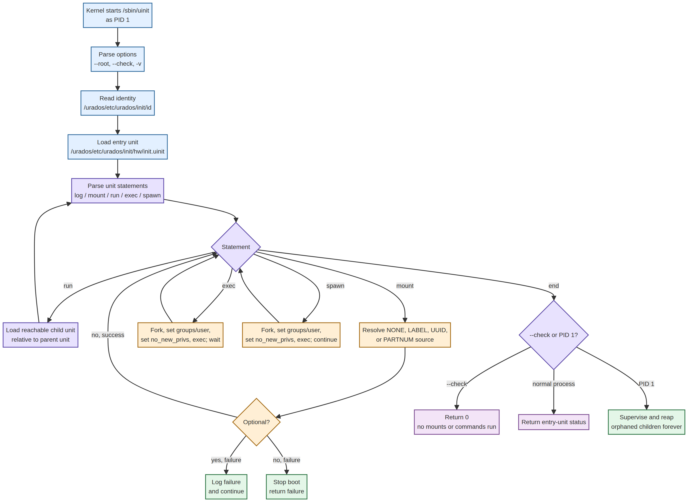

# Uinit init system

Uinit is the Urados native C init system. It can run as PID 1 on a target device or as a normal process against a staged root during development. It reads an identity file and a graph of `.uinit` units, mounts filesystems, starts commands, and reaps orphaned children.



## Build

From the repository root:

```sh
make uinit
```

The binary is written to `init/build/uinit`. Uinit requires a C11 compiler, `make`, `pkg-config`, and the `libblkid` development package.

To statically link a selected `pkg-config` module and its declared dependencies:

```sh
make uinit STATIC_LIB=blkid
```

This option affects only Uinit. See [Building Urados](BUILD.md) for dependency installation and linker details.

## Boot-time filesystem layout

Uinit reads these paths relative to the device root:

```text
/urados/etc/urados/init/id             OS identity
/urados/etc/urados/init/hw/init.uinit  entry unit
/urados/etc/urados/init/hw/**/*.uinit  reachable units
```

The identity file supplies variables available in unit log messages:

```ini
NAME="Urados"
VERSION=1.0.0
CHANNEL=stable
```

The entry unit is `init.uinit`. A `run` statement can load another unit; relative paths are resolved from the directory of the unit containing the statement.

## Unit syntax

A unit is line-oriented. Blank lines and comments beginning with `#` are ignored.

### Logging

```text
log booting ${NAME} ${VERSION} (${CHANNEL})
```

The supported variables are `${NAME}`, `${VERSION}`, and `${CHANNEL}`.

### Mounts

Mount a virtual filesystem without a device:

```text
mount NONE /proc type=proc opts=nosuid,nodev,noexec
```

Mount by filesystem label, UUID, or disk partition number:

```text
mount LABEL=urados-data /data opts=nosuid,nodev timeout=15
mount UUID=6f1d2a3c-4b5e-4f70-8a9b-0c1d2e3f4a5b /system type=ext4 opts=ro timeout=20
mount PARTNUM=sda:3 /mnt/backup type=ext4 opts=ro,noexec timeout=10
```

`opts=` contains comma-separated mount flags. `type=` supplies the filesystem type when needed, and `timeout=` controls how long Uinit waits for a device. `optional` logs a failed operation and continues:

```text
optional mount LABEL=optional-data /data opts=nosuid,nodev
```

### Running commands

`exec` waits for the command and fails the unit if the command fails. `spawn` starts a child without waiting:

```text
exec -- /bin/sh -c "echo boot-step-done"
spawn -- /urados/bin/example-service
```

Commands can run under a specified identity when Uinit has the privileges required to change it:

```text
exec user=nobody group=nogroup groups=nogroup -- /bin/true
```

Use `optional` when a failed command must not stop the unit:

```text
optional spawn user=nobody group=nogroup -- /bin/optional-service
```

### Including other units

```text
run units/services.uinit
```

Nested units are bounded to prevent recursive configuration from exhausting the process.

### Permissions and ownership

Set exact permission bits with octal modes, or use `+X` for the standard conditional execute mode:

```text
chmod 0755 /urados/bin/user/tool
chmod -R +X /data
chown root:root /data
```

`chmod +X` adds all three execute/search bits to directories and to files that already have at least one execute bit. It leaves ordinary non-executable files unchanged. The `-R` form applies the same rule throughout a directory tree and does not follow symbolic links. Uinit currently accepts octal modes and the exact `+X` form; other symbolic modes such as `u+x` are rejected.

## Command-line options

```text
uinit [--root DIR] [--check] [-v]
```

- `--root DIR` reads all paths below `DIR` instead of `/`. Use this for staged tests and development.
- `--check` parses the identity file and every reachable unit but performs no mounts and runs no commands.
- `-v` traces units, mounts, and commands.
- `-h` or `--help` prints usage.

As PID 1, Uinit does not exit after the entry unit: it supervises and reaps orphaned processes. Outside PID 1, it returns success or failure after the entry unit finishes.

## Validate a configuration

Build and check the tracked example tree:

```sh
make uinit
make -C init check-example
```

Equivalent direct invocation:

```sh
init/build/uinit --root init/examples/root --check -v
```

The example demonstrates identity expansion, virtual filesystems, device-based mounts, nested units, blocking commands, and background processes. It is a configuration example, not a complete production device configuration; adapt device names, labels, UUIDs, paths, and service identities to the target image.

## Tests

Run the Uinit unit and integration tests with:

```sh
make -C init test
```

The suite covers identity parsing, unit syntax, variable expansion, nested units, optional and required failures, command identity changes, virtual filesystem mounts, block-device discovery, and PID 1 reaping. Mount, identity, and PID 1 cases require passwordless `sudo`. Loop-device cases also require `losetup`, `sfdisk`, and `mkfs.ext4`.

All test artifacts are placed below `init/build/test` and are removed by the test cleanup handler. Staged `--root` execution uses a plain path prefix/chroot-style test tree and must not be treated as an isolation boundary.

## Integration checklist

Before using Uinit as a device's PID 1:

1. Place the binary in the target image or initramfs and configure the kernel/bootloader to execute it as PID 1.
2. Provide `/urados/etc/urados/init/id` with the target's name, version, and channel.
3. Provide a complete `hw/init.uinit` entry unit and all units reachable through `run`.
4. Replace the example device identifiers with the target's real labels, UUIDs, partition numbers, mount options, and service paths.
5. Ensure every command and requested user/group exists in the target image.
6. Test with `--check`, then exercise the boot flow in a disposable target or virtual machine before deployment.
7. Confirm that PID 1 remains running, expected child processes are reaped, and command or mount failures are reported as expected.
